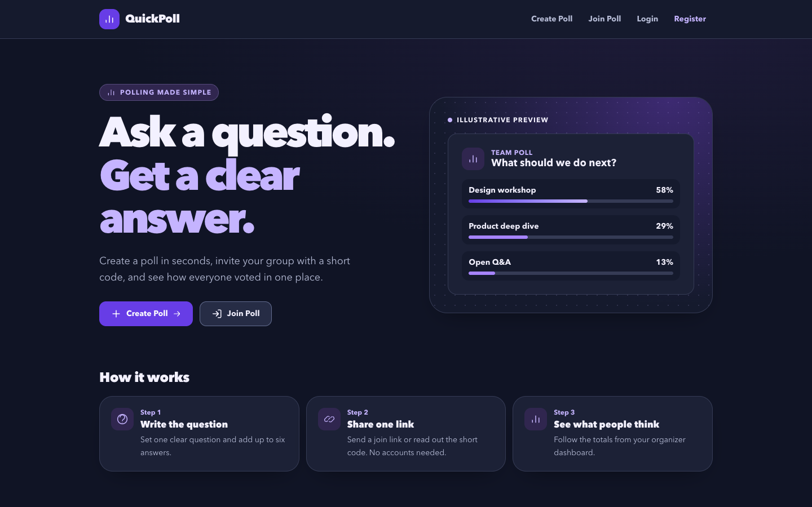
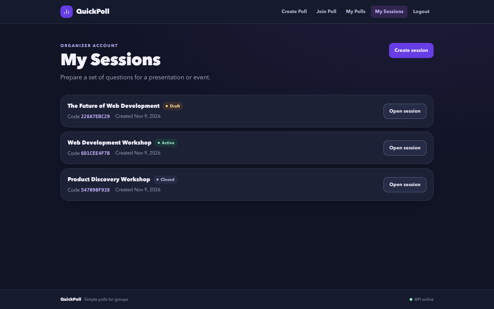
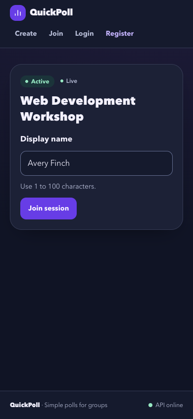
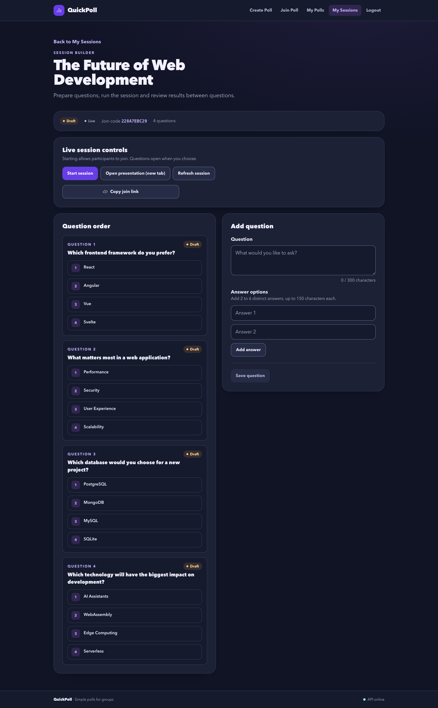
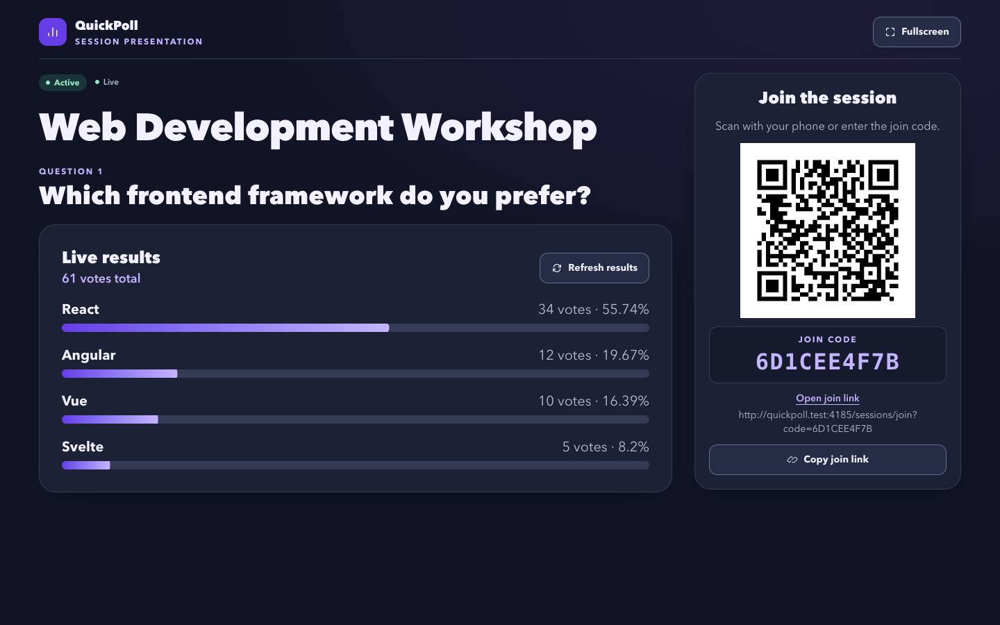
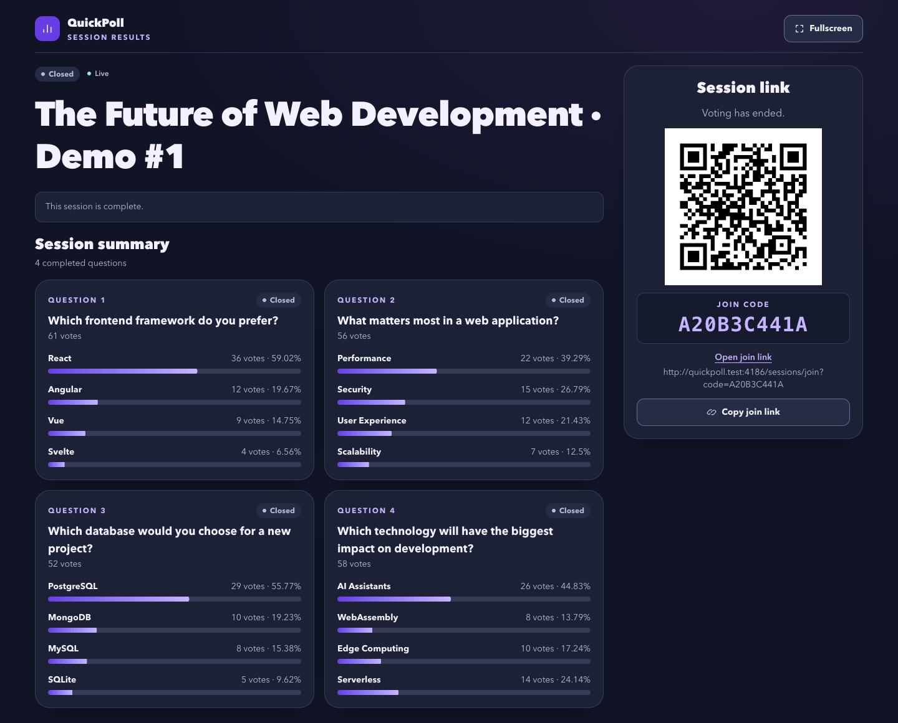

# QuickPoll

QuickPoll is a real-time polling app for workshops, classes, and team meetings. Run a single poll or a sequence of questions, share a join code or QR code, and show live results on a shared screen. Participants can vote from their phones without creating an account.

## Screenshots



| Organizer dashboard | Mobile participant view |
| --- | --- |
| [](docs/screenshots/02-my-sessions.png) | [](docs/screenshots/04-participant-join.png) |

<details>
<summary>Session builder, live presentation, and final results</summary>

**Session builder**



**Live presentation**



**Final results**



</details>

## How it works

### Multi-question sessions

1. Register, sign in, and create a session in **My Sessions**. Add questions in the order you want to run them. Each question takes two to six distinct answer options.
2. Start the session to admit participants, then share the session link, join code, or presentation QR. The first question opens when the organizer explicitly opens it.
3. Participants enter a display name once and use the same session credential across questions. Open and close one question at a time. You can review results between questions while the session continues to admit new participants.
4. Closing the final question completes the session. The public summary shows aggregate results for each question in order.

### Standalone polls

1. Choose **Create Poll**, add one question and two to six options, then open its organizer dashboard. Polls created while signed in appear in **My Polls**. Guest organizers manage their poll from the tab that holds its organizer token.
2. Choose **Open Presentation** for a public results screen and join QR, then activate the poll. Participants join with the link or code and a display name.
3. Each participant credential can submit one vote. The presentation updates as votes arrive. Close the poll to end voting and leave its final results available.

## Architecture

| Layer | Stack and role |
| --- | --- |
| [Client](client/) | React, TypeScript, Vite, and Tailwind CSS. Organizer dashboards, mobile ballots, public presentation pages, and locally generated QR codes via `qrcode.react`. |
| [Server](server/) | Node.js and Express. REST routes handle authentication, lifecycle changes, voting, and result queries. Services and repositories use `pg` to access PostgreSQL. |
| [Database](db/) | PostgreSQL 18. Stores organizers, sessions, polls, answer options, participants, and votes. Transactions and database constraints enforce vote uniqueness and protect lifecycle changes. |
| Realtime | Socket.IO on the Express HTTP server. Vite proxies both `/api` and `/socket.io` in development. |

Clients subscribe by public join code using `join-poll` or `join-session`, and unsubscribe with the corresponding `leave-poll` or `leave-session` event. Standalone rooms emit `poll-status-updated` and `results-updated`. Session rooms emit `session-state-updated`, `session-results-updated`, and `session-completed`. These events tell clients to fetch fresh HTTP state or results. Clients rejoin their room and refresh after reconnecting.

### Authentication and security

- Organizer passwords are hashed with scrypt. Signing in issues a 30-day, host-only, HttpOnly, SameSite=Lax cookie scoped to `/api`. The database stores a digest of the session token. Production cookies require HTTPS.
- Session management checks organizer ownership. Auth endpoints that write state and cookie-authenticated organizer writes check the exact browser origin. Register and login share an in-memory per-IP rate limit.
- Standalone lifecycle actions accept the owner's cookie or the original organizer bearer token. Participants use bearer credentials issued when they join. Session participant credentials and standalone organizer tokens are stored as SHA-256 digests.
- Join codes, presentations, and aggregate results are public. Treat organizer and participant credentials as private.

See the [server guide](server/README.md) for the HTTP and Socket.IO contracts and [client guide](client/README.md) for proxy configuration.

## Run locally

Use Node.js 22.13+ or a newer supported LTS release, npm, Docker with Compose v2, Bash, `curl`, `lsof`, and `openssl`. Run the commands from the root of a fresh clone. Docker runs PostgreSQL. The API and frontend run on the host.

### 1. Install dependencies and configure the environment

```sh
npm ci --prefix server
npm ci --prefix client
```

Create the three local files below. Generate a local password with `openssl rand -hex 24` and use the same value for `DB_PASSWORD` in both files that define it. All three files are ignored by Git. For an existing Compose volume, use the password with which that database was initialized.

**`.env`**

```dotenv
DB_PASSWORD=replace-with-your-local-password
```

**`server/.env`**

```dotenv
DB_HOST=127.0.0.1
DB_PORT=5434
DB_NAME=quickpoll
DB_USER=quickpoll
DB_PASSWORD=replace-with-your-local-password
PORT=3001
# QUICKPOLL_ALLOWED_ORIGINS=http://your-lan-host:5173
```

**`client/.env.local`**

```dotenv
VITE_PUBLIC_APP_URL=http://localhost:5173
# VITE_API_BASE_URL=/api
```

`VITE_PUBLIC_APP_URL` controls the origin used in join links and QR codes. If it is unset, links use the current browser origin. `VITE_API_BASE_URL` defaults to `/api`. For a manual Vite launch with a custom backend port, set `QUICKPOLL_API_PROXY_TARGET` in the launching shell. The development scripts expect the default API and frontend ports. `QUICKPOLL_ALLOWED_ORIGINS` accepts comma-separated exact origins, including ports where applicable, with no trailing slash.

### 2. Start PostgreSQL and apply the schema

```sh
docker compose up -d --wait db
for migration in db/00[1-5]_*.sql; do
  docker compose exec -T db psql -X -v ON_ERROR_STOP=1 \
    -U quickpoll -d quickpoll -f - < "$migration" || break
done
```

Proceed once all five migrations succeed. Compose binds PostgreSQL to loopback on port `5434` and persists data in the `postgres_data` volume.

| Migration | Adds |
| --- | --- |
| [001](db/001_init.sql) | Standalone polls, options, participants, and votes |
| [002](db/002_organizer_auth.sql) | Standalone organizer token hashes |
| [003](db/003_organizer_accounts.sql) | Organizer accounts, login sessions, and poll ownership |
| [004](db/004_multi_question_sessions.sql) | Multi-question sessions, question ordering, and session participants |
| [005](db/005_live_sessions.sql) | Hashed session participant credentials and per-question voting constraints |

These are forward SQL migrations applied manually. For an existing database, run only the missing migrations in order. See the [database guide](db/README.md).

### 3. Start and stop the app

```sh
./dev.sh
```

Open [QuickPoll on localhost](http://localhost:5173). The launcher checks ports `3001` and `5173`, starts or reuses the Compose database, and waits for the API and frontend to respond. To check the database connection from another terminal, run `curl -fsS http://localhost:3001/api/health/db`.

Press **Ctrl+C** in the launcher terminal to stop the API and frontend. You can also run `./stop.sh` to stop verified QuickPoll listeners on the two app ports. PostgreSQL stays up in either case. To stop it while retaining its data, run `docker compose stop db`.

### Test a QR code over Wi-Fi

1. Connect the host computer and phone to the same trusted Wi-Fi network. Find the host's LAN IPv4 address and form the frontend origin using HTTP and port `5173`. On macOS, `./dev.sh` prints a LAN URL when it detects an address.
2. Set `VITE_PUBLIC_APP_URL` in `client/.env.local` to that origin. For organizer sign-in or account actions from the LAN URL, also add that exact origin to `QUICKPOLL_ALLOWED_ORIGINS` in `server/.env`. Restart the launcher after changing the files. Localhost and the LAN origin have separate cookies.
3. Open the LAN URL on the phone. On the host, open the poll or session presentation, scan its QR code with the phone, join, and cast a vote while the poll or question is open. Confirm the presentation updates. The phone uses the frontend port for both API and Socket.IO traffic through Vite.

### Checks

```sh
npm --prefix server test
npm --prefix client test
npm --prefix client run lint
npm --prefix client run build
```

The default server run skips the PostgreSQL integration test. To include it, point `QUICKPOLL_TEST_DATABASE_URL` at a disposable PostgreSQL database and rerun `npm --prefix server test`. The test creates and removes a scratch schema.

## Seed a local demo

Create a draft or completed session with exactly four questions under your own organizer account. The seeder copies its questions and options into a separate completed session for the same organizer and generates 64 fictional participants and 227 votes. It requires the migrated local PostgreSQL 18 Compose database on loopback port `5434`, with database and role both named `quickpoll`.

Find the source and owner IDs in your local database.

```sh
docker compose exec -T db psql -X -U quickpoll -d quickpoll \
  -c 'SELECT id, organizer_id, title, status FROM poll_sessions ORDER BY id;'
```

Replace `SESSION_ID` and `OWNER_ID` below. Run the read-only preview first and check the planned title and vote counts.

```sh
node server/scripts/seed-demo.js --create-demo-session \
  --source-session-id SESSION_ID --owner-id OWNER_ID --dry-run
```

To create the demo after reviewing the preview, repeat the command with `--confirm` in place of `--dry-run`. The source session and its data are preserved. Keep the generated `· Demo #<source ID>` title suffix so the seeder can detect an existing copy and refuse a duplicate.

## Limitations

- One vote per credential limits repeat submissions. Anonymous joining allows someone to obtain a fresh credential, and display names do not establish identity.
- The UI reports vote totals per question. A count of joined participants is unavailable. Question editing and reordering are outside the current builder workflow.
- Guest organizer tokens and participant credentials are stored in the current browser tab. Organizer accounts provide access to account-owned polls and sessions across devices.
- The Compose setup is for local development. For deployment, serve the built SPA over HTTPS with a fallback to `index.html`, proxy `/api` and `/socket.io` on the same origin with WebSocket upgrades, and configure the exact HTTPS origin on the API. Socket.IO broadcasts and authentication rate limits are process-local.
